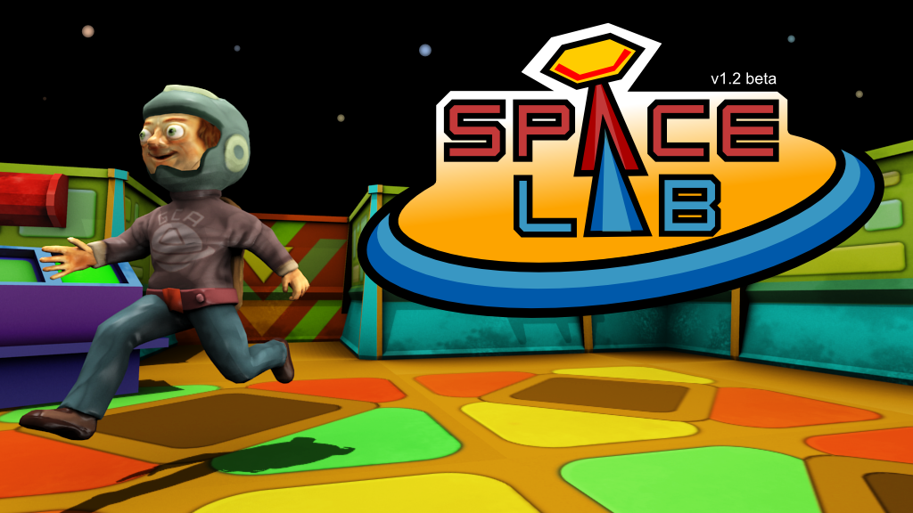
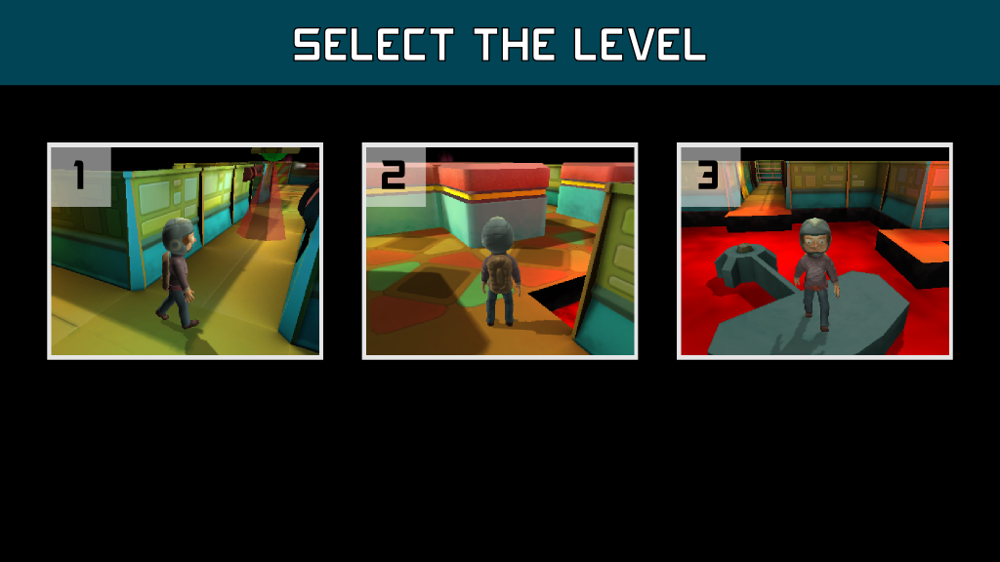

# SpaceLab



A 3D arcade game made with Unity 4.5 about 10 years ago, now ported to the web with Three.js.
You move a character through rooms and corridors and turn on all the computers to open the exit door and reach the teleport.
Watch out for UFOs, lasers, lava and turning platforms!

## THIS APPLICATION IS UNDER ACTIVE DEVELOPMENT, BUT STILL CONSIDERED BETA

## Technologies

[](https://threejs.org/)
[](https://developer.mozilla.org/en-US/docs/Web/JavaScript)
[](https://vitejs.dev/)
[](https://pnpm.io/)
[](https://github.com/features/actions)

## Screenshots



## Try it online

Every push to `main` is built and published with GitHub Actions.
Open the GitHub Pages link of this repository (Settings > Pages shows the address).

## How to play

- Touch the 4 computers of the level to turn them on.
- When all the computers are on, go to the exit door. It opens by itself.
- Reach the teleport to finish the level.
- You have 3 lives. UFOs, lasers and lava take one life and start the level again.
- Your medal is the number of lives you have left: 1 bronze, 2 silver, 3 gold.

## Controls

Keyboard and mouse:

- `WASD` or arrow keys: move (relative to the camera)
- `Shift`: run
- `Space`: jump
- Right mouse button or `Alt`: put the camera behind the character
- `N`: sound on / off

Phone or tablet (landscape): the touch controls are shown by themselves.

- Left half of the screen: floating joystick. Push it all the way to run
- `JUMP` button: jump
- `EXIT` button: back to the level list

To try it on a phone in development mode, run `pnpm dev --host` and open the address shown on the screen (phone and computer in the same network).

## Installation

- Install Node.js 18 or newer and pnpm
- Run the command `pnpm install`

## Execute the unit tests

- Run `run_tests.sh`

## Running in development mode

- Run `run.sh` or `pnpm run dev`
- Open `http://localhost:5173/`
- To go straight to a level: `http://localhost:5173/?level=1` (or 2, 3)

## Build to web

- Run `pnpm build`
- The game is created in the `dist` folder
- Run `pnpm preview` to try it

## Deploy to GitHub Pages

- In GitHub go to Settings > Pages > Source and choose "GitHub Actions" (one time only)
- Push to `main`. The workflow `.github/workflows/deploy.yml` runs the tests, builds the game and publishes it

## Project structure

- `src/core`: game loop, assets, sound, saving and screen navigation
- `src/game`: level loading, player, collisions, computers and door, dangers, moving parts and particles
- `src/ui`: main menu, level selector, tutorial and credits
- `public`: levels (JSON), models (FBX), textures, sounds and baked animations
- `tools`: Python scripts used to convert the Unity project (not needed to play)
- `tests`: logic tests that run with plain Node.js
- `unity-meta`: `.meta` files of the original Unity project

The version is in `manifest.json` and it must be the same in `public/manifest.json` and `package.json`.
The plan of the port is in `ROADMAP.md`.

## Utility to convert the Unity scenes to levels

The levels are made from the Unity scenes with a Python tool:

- Use `binary2text.exe` of Unity 4.5 to make a `.txt` file for each scene and material
- Make `guids.txt`: `grep -rH "^guid:" --include=*.meta Assets > guids.txt`
- Run:

```bash
python tools/unity2json.py scene scene1.unity.txt public/levels/level1.json unity-meta/guids.txt unity-meta
python tools/unity2json.py materials public/levels/materials.json unity-meta/guids.txt unity-meta --mats Assets/Materials
```

## Utility to bake the character animations

The animations of the FBX are baked to `public/animations/character.json` (needs Python 3 and numpy):

```bash
python tools/bake_animations.py public/models/character.fbx public/animations/character.json 30
```

## Saved data

The game saves the last level finished, the medals and if the tutorial was seen in the browser (`localStorage`).
To start from zero, clear the site data of the page.

## Credits

Original game: 3D, programming and music by Daniel Arellano Aliaga.
Made with Blender, Gimp, Inkscape, LMMS and Unity. Ported to the web with Three.js.

## Resources

- [Three.js documentation](https://threejs.org/docs/)
- [Vite guide](https://vitejs.dev/guide/)
